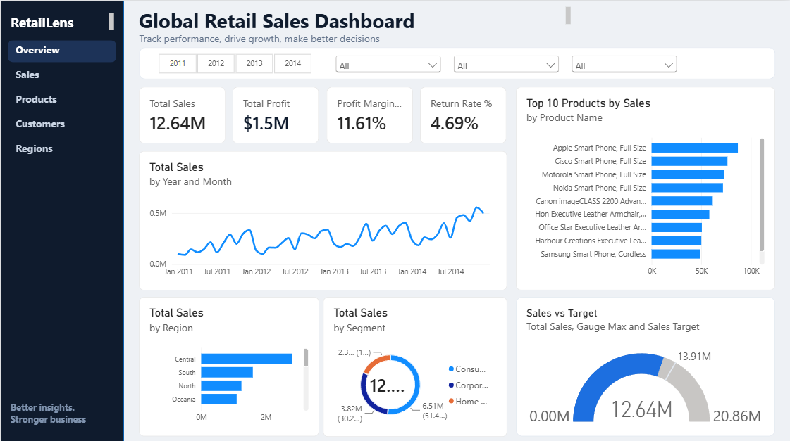
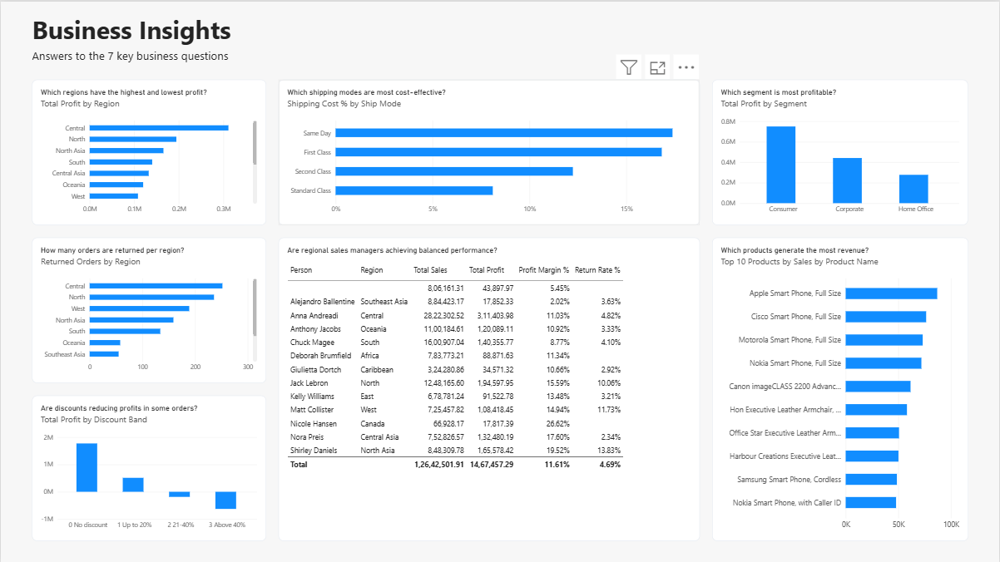
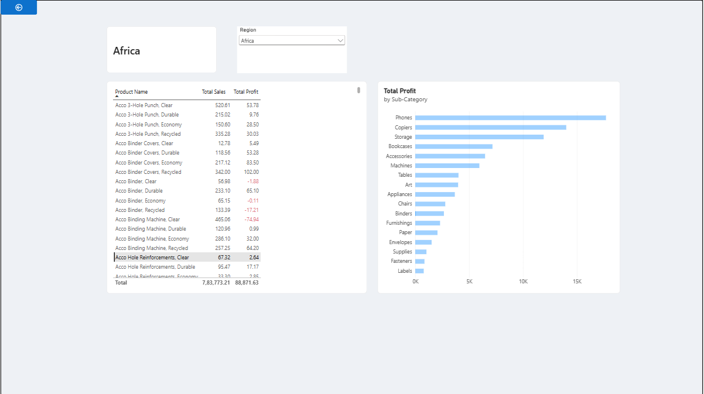
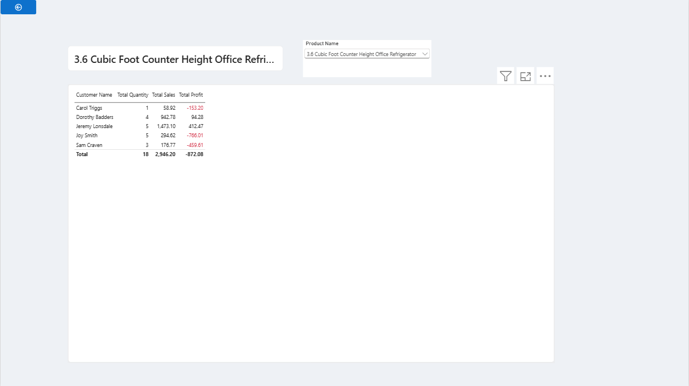

# 🌍 Global Retail Sales Dashboard | Power BI

An interactive **Power BI** dashboard that analyzes sales, profit, discounts and returns across regions, customer segments and product categories for a global retail business.

---

## 📌 Project Overview
The retail business sells **Furniture, Office Supplies and Technology** products across multiple markets. This project answers questions like:
- Which regions are most and least profitable?
- Do higher discounts reduce profit?
- Which customer segments and products drive the most revenue?
- How do returned orders affect overall performance?

---

## 📸 Dashboard Preview

### 1️⃣ Main Dashboard

### 2️⃣ Insights

### 3️⃣ Region Drill-through

### 4️⃣ Customer Drill-through

---

## 🗂️ Data Model
- **Orders** (Fact table): sales transactions
- **Returns** (Dimension): returned orders
- **People** (Dimension): regional managers

Relationships: Orders ↔ Returns (Order ID) | Orders ↔ People (Region)

📂 Dataset: Global Superstore (publicly available sample dataset)

---

## 🧹 Data Cleaning (Power Query)
- Standardized date columns
- Converted Sales and Profit to numeric values
- Handled missing values and removed duplicates
- Created Profit Margin and Returned Flag columns

---

## 📐 DAX Measures
Total Sales • Total Profit • Total Quantity • Profit Margin % • Return Rate % • Average Shipping Cost • Top 10 Products by Sales

---

## 📊 Dashboard Features
- **KPI cards:** Sales, Profit, Profit Margin %, Return Rate %
- **Charts:** Monthly sales trend, sales by region, segment contribution, top 10 products, sales vs target
- **Interactivity:** Slicers (Year, Region, Segment, Category), drill-through (Region → Customer), conditional formatting for negative profit

---

## 💡 Key Insights

- 📈 **Overall performance (2011–2014):** Total sales of **12.64M**, profit of **$1.5M**, a profit margin of **11.61%** and a return rate of **4.69%**.
- 📊 **Steady growth:** Monthly sales grew from roughly 0.1M in early 2011 to about 0.5M by late 2014, with recurring seasonal peaks.
- 🎯 **Sales vs Target:** Achieved 12.64M against a 13.91M target (~91%).
- 🌍 **Regions:** Central is the top region by both sales and profit, but it also records the highest number of returned orders.
- 💸 **Discounts hurt profit:** Orders with no discount generate the highest profit, while discounts above 20% turn profit negative. Discounts above 40% cause the largest losses.
- 👥 **Segments:** Consumer contributes 51.4% of sales (6.51M) and is the most profitable segment, followed by Corporate (30.2%) and Home Office.
- 📱 **Products:** Technology products, especially smartphones, dominate the Top 10 by sales. Apple Smart Phone (Full Size) is the top product.
- 🚚 **Shipping:** Standard Class has the lowest shipping cost as a share of sales (~8%), while Same Day is the most expensive (~17%).
- 🧑‍💼 **Manager performance:** Anna Andreadi (Central) leads in total sales (2.82M), while Southeast Asia has the lowest profit margin (2.02%) and West has the highest return rate (11.73%).

## ✅ Recommendations
- Cap discounts at 20% to avoid loss-making orders.
- Encourage Standard Class shipping where delivery time allows.
- Investigate high return rates in Central and West regions.
- Review pricing and costs in Southeast Asia to improve its low margin.

---

## 🛠️ Tools Used
`Power BI` • `Power Query` • `DAX` • `Data Modeling` • `Data Visualization`

---

## 🚀 How to Use
1. Download the `.pbix` file from this repository
2. Open it in **Power BI Desktop**
3. Explore the dashboard using slicers and drill-through pages

---

## 👤 Author
**Laxman Thorwat** | [GitHub](https://github.com/laxman-444)

⭐ If you found this project useful, please star the repository!
